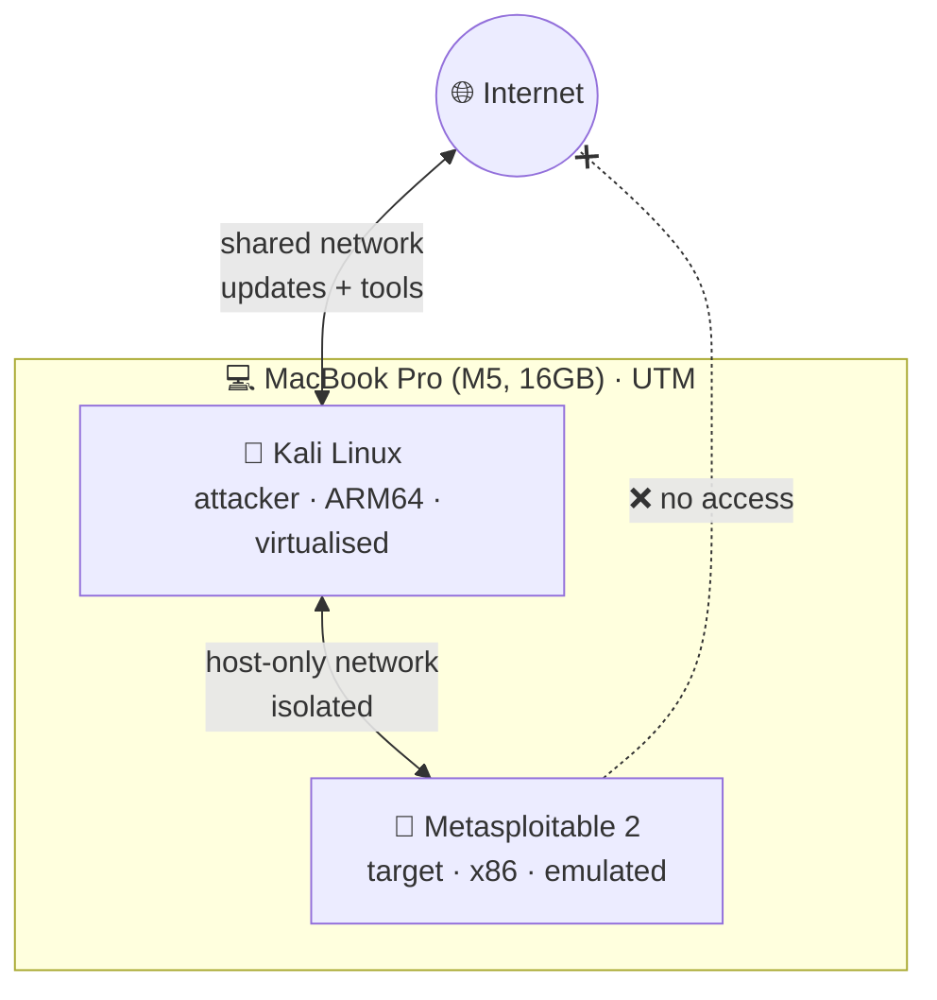

# 🧪 home-lab

> `$ cat purpose.txt`
> My own isolated hacking lab, running on a MacBook. Somewhere to attack things legally, break stuff and learn how it works.

---

### `$ cat network.txt`

Metasploitable is **deliberately vulnerable**, so it only sits on the host-only network. It can talk to Kali and nothing else.

---

### `$ cat machines.txt`
| VM | Role | How it runs in UTM | Networks |
|---|---|---|---|
| Kali Linux | Attacker | **Virtualize** (native ARM64, fast) | Shared + Host-only |
| Kali clean | Backup | Clone of a fresh Kali install | — |
| Metasploitable 2 | Target | **Emulate** (x86 on ARM, slower) | Host-only only |

**Why UTM and not VirtualBox?** The M5 is Apple Silicon (ARM). UTM can run ARM VMs natively and emulate x86 ones when needed.

---

### `$ cat setup.log`
1. Installed **UTM** on the Mac
2. Installed **Kali Linux (ARM64)** in Virtualize mode
3. Updated Kali with `sudo apt update && sudo apt full-upgrade`
4. Cloned it as **Kali clean**, so I can reset if I wreck it
5. Installed **Metasploitable 2** in Emulate mode, on a host-only network
6. Gave Kali a **second network adapter** on the same host-only network
7. Tested with `ping` between the two
8. First `nmap` scan from Kali against Metasploitable

---

### `$ cat problems.txt`
| Problem | Cause | Fix |
|---|---|---|
| Black screen on Kali install | No display output during install | Added a **Serial** device in UTM, removed it after install |
| Kali had no internet | My **Mac's VPN** was blocking the VM's network | Turned the VPN off while using the lab |
| Metasploitable is slow | It's x86, so UTM has to emulate it on ARM | Nothing to fix. That's the trade-off |

---

### `$ cat rules.txt`
- 🔒 Metasploitable **never** goes on a network with internet access
- 🔒 Attacks only go from my Kali to my own targets
- 🔒 No real passwords or personal data inside the lab VMs
- 🔒 Reset to the clean clone if something gets weird

---

### `$ cat roadmap.txt`
- [x] Kali + Metasploitable talking on an isolated network
- [x] First nmap scan
- [ ] Write-ups for each vulnerable service I find
- [ ] Add DVWA and OWASP Juice Shop with Docker for web practice
- [ ] Capture and analyse lab traffic with Wireshark

---

> ⚠️ Everything here runs on my own machines, on an isolated network. Don't point any of this at systems you don't own.

[⬅ cyber-notes](https://github.com/Fersxvv/cyber-notes) · [cret.fyi](https://cret.fyi)
